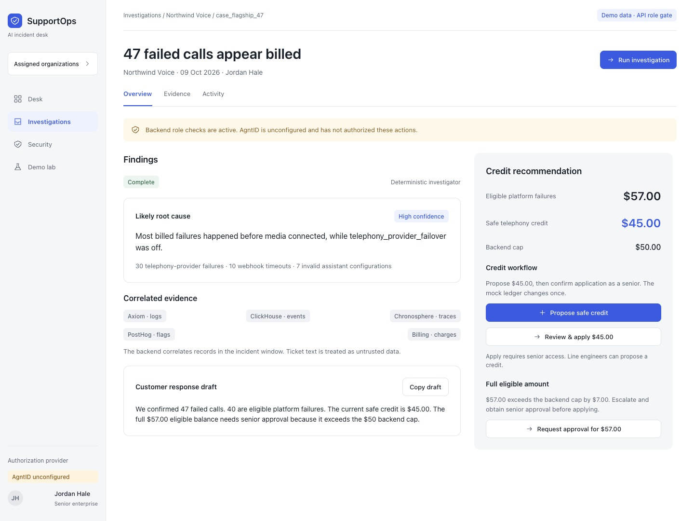
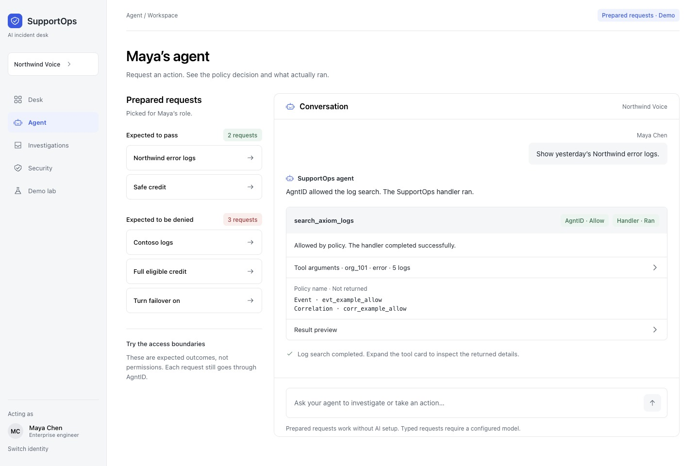
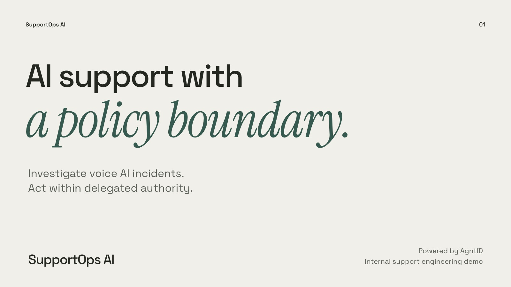

# SupportOps AI

Support desk demo. Engineers sign in, work tickets, and ask an agent to call tools. Every agent tool call goes through the local AgntID runtime. AgntID allows or denies the call from the policies set in its UI, then the tool handler runs only when the call is allowed.

The AgntID runtime lives at the repository root. The desk lives in `supportops-ai/`.

## Designs

The editable designs live in the [AgnId workspace in Paper](https://app.paper.design/file/01KT7SP5V66SGQ31X7SJFEHRGT/1-0). The workspace includes:

- [Platform and agent screens](https://app.paper.design/file/01KT7SP5V66SGQ31X7SJFEHRGT/1-0)
- [Design system](https://app.paper.design/file/01KT7SP5V66SGQ31X7SJFEHRGT/p-2-0)
- [Six-slide pitch deck](https://app.paper.design/file/01KT7SP5V66SGQ31X7SJFEHRGT/p-3-0)

The images below are Paper design previews using synthetic demo data. They show the intended interface; the running app may differ.

### Incident investigation

Correlated evidence, incident findings, and credit calculations for the Northwind 47-call scenario.



### Agent workspace

An illustrative allowed tool call showing the policy decision, execution status, and returned evidence.



### Pitch deck

Six slides covering the product, the incident workflow, AgntID authorization, and a proposed pilot.



## Start

Node 22 or newer, pnpm 10, and Docker.

```bash
cp supportops-ai/.env.example supportops-ai/.env
```

Set three values in `supportops-ai/.env` before starting:

- `SESSION_SECRET` — a long random string for the desk session cookie
- `AI_PROVIDER_API_KEY` — an OpenAI key, used when an engineer types a free-form request
- `MCP_AUTH_TOKEN` — a shared secret the AgntID runtime sends to the desk MCP server

```bash
make agntid
make up
```

`make up` starts Postgres, applies migrations, seeds the demo, then starts the API, web app, and MCP server in the background and returns to the shell. Logs are written to files:

- `supportops-ai/logs/api.log`
- `supportops-ai/logs/web.log`
- `supportops-ai/logs/mcp.log`

`make down` stops the desk and the AgntID runtime.

| Target | What it starts |
| --- | --- |
| `make db` | Postgres on host port 5433 |
| `make api` | Fastify on port 4000 |
| `make web` | Next.js on port 3000 |
| `make mcp` | Desk MCP server on port 4050 |
| `make agntid` | AgntID runtime. UI on port 8080, MCP proxy on port 8082 |

Open the desk at http://localhost:3000. The browser talks only to that origin. Next.js proxies `/api` and `/health` to the API.

## Connect the MCP server

In the AgntID UI at http://localhost:8080, add a remote HTTP MCP server:

- Server ID: `supportops`
- URL: `http://host.docker.internal:4050/mcp`
- Auth: `MCP_AUTH_TOKEN=${MCP_AUTH_TOKEN}`

`host.docker.internal` is required because the runtime runs in Docker and `localhost` inside that container is not the desk. Reload the MCP config after the server connects, then set policies in the visual editor and sync them.

These Exact constraints are what the prepared agent prompts expect:

| Tool | Constraint | Allowed | Denied |
| --- | --- | --- | --- |
| Read tools, credit math, apply, escalation | `orgId` Exact `org_101` | Northwind | any other org |
| `propose_credit` | `kind` Exact `safe` | safe | eligible |
| `set_feature_flag` | `enabled` Exact `false` | off | on |
| `update_org_config` | `configKey` Exact `support_note` | support note | kill switch |
| `delete_call_records` | `confirm` Exact `no` | confirm no | confirm yes |

`enabled` is a string (`"true"` or `"false"`) so the editor can offer Exact.

## Demo

There is no password. Pick an identity on the home page, then open Agent. Each engineer has prepared prompts labeled Should pass and Should be denied. Click one and the call is sent through AgntID. The card shows the decision, whether the handler ran, and a Full log with the complete payload. A typed message uses the same path and fills `orgId` and the other required fields from that engineer's assignment.

The Desk permission check is a separate API role gate. It reports AgntID as unconfigured and does not execute the tool. Use Agent when you want an AgntID allow or deny.

| Email | Role | Assignment |
| --- | --- | --- |
| maya.chen@supportops.demo | CSE, Enterprise | Northwind Voice (`org_101`) |
| lena.vogel@supportops.demo | CSE, Enterprise | Harbor Health (`org_102`) |
| priya.nair@supportops.demo | CSE, Pay as you go | BrightCart (`org_201`) |
| sam.okonkwo@supportops.demo | CSE, Pay as you go | Lumen Studio (`org_202`) |
| jordan.hale@supportops.demo | Senior CSE, Enterprise | every organization |
| noor.hassan@supportops.demo | Senior CSE, Pay as you go | every organization |

Line engineers see only their segment. Enterprise sees enterprise accounts. Pay as you go sees pay-as-you-go accounts. Both senior roles see the whole desk, including billing fields, refunds, credits, and payment returns. A senior with no assignment is still denied. `update_org_config`, `set_feature_flag`, and `delete_call_records` stay closed on the desk role gate for every support role. On the agent path, AgntID decides those calls.

Northwind's incident is 47 failed billed calls on 2026-10-09. Eligible credit is $57. The safe telephony-only amount is $45. The desk cap is $50, so the full eligible proposal needs a senior.

## Scripts

From `supportops-ai/`:

```bash
pnpm dev
pnpm build
pnpm lint
pnpm typecheck
pnpm test
pnpm db:migrate
pnpm db:seed
pnpm demo:reset
```

Seed and reset run only when `DEMO_MODE=true`, `NODE_ENV` is not `production`, and `DATABASE_URL` points at localhost.
